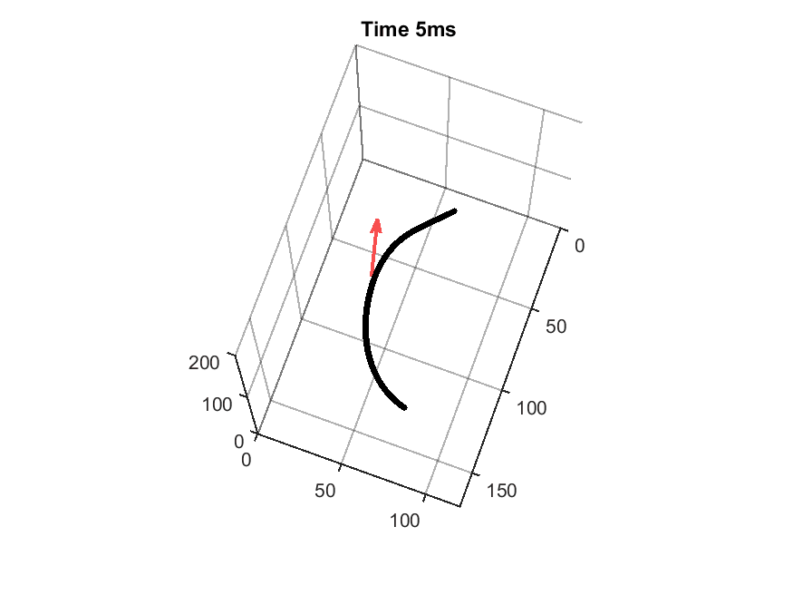
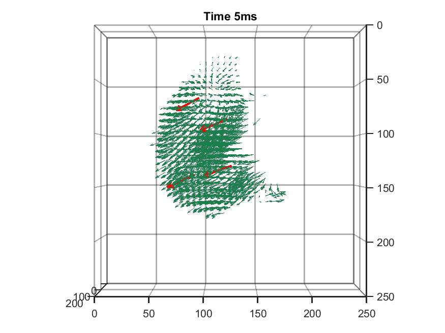
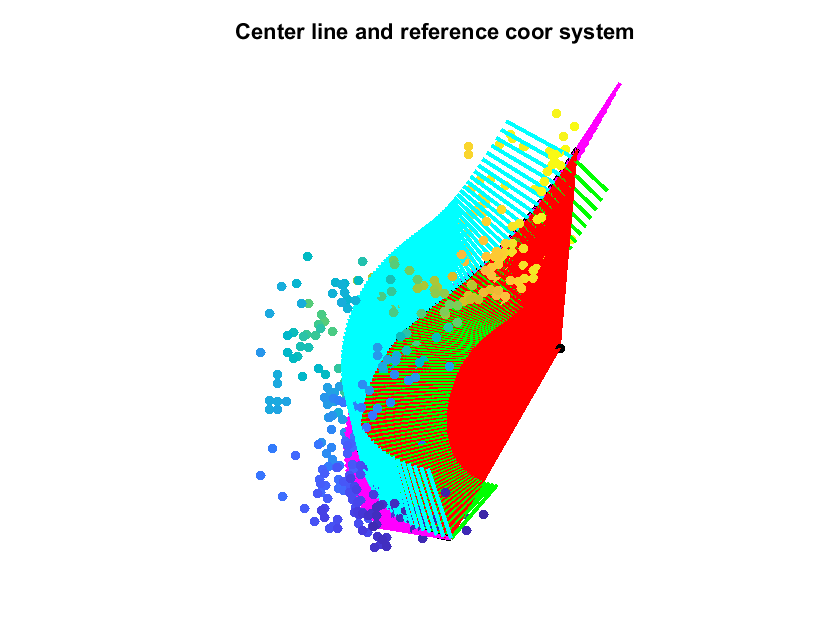
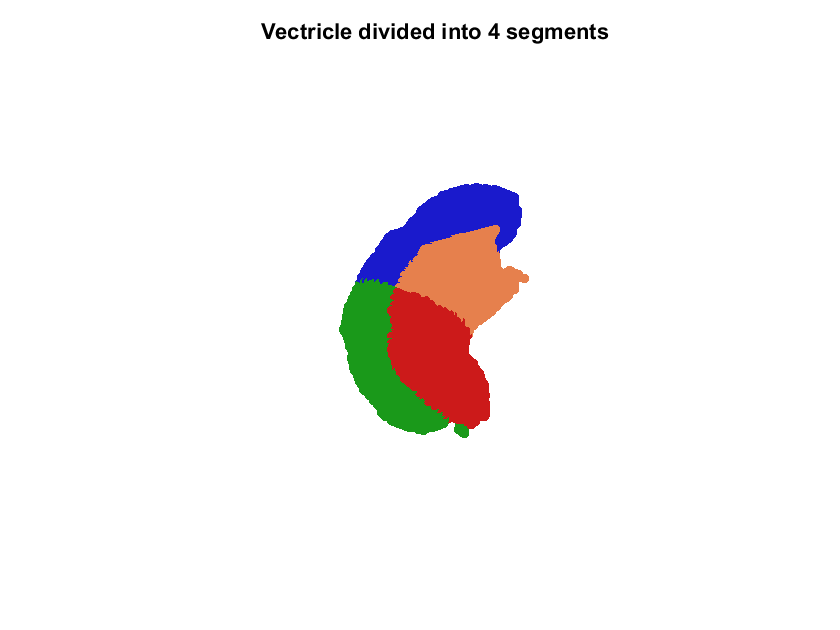

### Matlab scripts processing velocity maps of embryonic zebrafish heart dynamics
Supporting codes to process image data acquired by [*Wang, Zhaoqiang, et al. "A hybrid of light-field and light-sheet imaging to study myocardial function and intracardiac blood flow during zebrafish development." PLoS computational biology 17.7 (2021): e1009175.*](https://journals.plos.org/ploscompbiol/article?id=10.1371/journal.pcbi.1009175)
 
 
#### Flowing blood cells (left) and contracting myocardium (right) 

#### Ventricle anatomy reparameterization by center line

### Retrospective cardiac gating algorithm
The post-acquisition image alignment algorithm (retrospective gating) used the adapted code from Lee, Juhyun, et al. "4-Dimensional light-sheet microscopy to elucidate shear stress modulation of cardiac trabeculation." The Journal of clinical investigation 126.5 (2016): 1679-1690.

Consult the repository [heart_beat_synchronization](https://github.com/aaronzq/heart_beat_synchronization)
